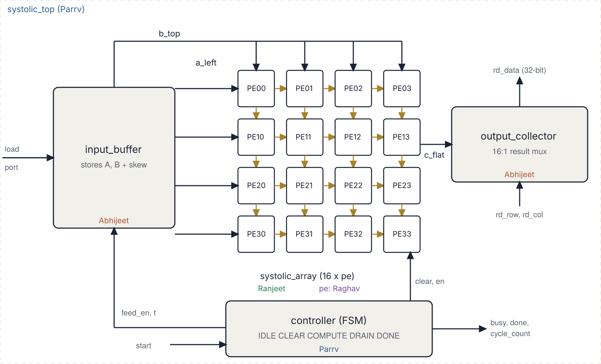

# Section 2: Architecture

**Author:** Parrv

## 2.1 Block diagram

| Module | Role | Owner |
|---|---|---|
| `pe` | One MAC: `acc <= acc + a_in * b_in`; passes `a_in` right and `b_in` down one clock later | Raghav |
| `systolic_array` | 4x4 grid of PEs built with `generate` loops | Ranjeet |
| `input_buffer` | Stores A and B; produces the skewed edge inputs `a_left`, `b_top` | Abhijeet |
| `output_collector` | 16:1 mux that reads `C[rd_row][rd_col]` from the accumulators | Abhijeet |
| `controller` | FSM that clears, feeds and drains the array and counts cycles | Parrv |
| `systolic_top` | Connects the blocks above | Parrv |
| `sequential_mac` | One-MAC baseline with the same interface | Malhar |

## 2.2 Number format and parameters

| Parameter | Value | Reason |
|---|---|---|
| `N` | 4 | 4x4 array |
| `DW` | 8-bit signed (-128 to 127) | Fixed-point inputs keep the datapath small |
| `AW` | 32-bit signed | The largest result is 4 x (-128 x -128) = 65,536, which needs 18 bits; 32 bits leaves margin |
| `TW` | 8 bits | Width of the feed counter `t` (reaches 9) |
| Clock / reset | One clock `clk`, synchronous active-high `rst` | Same convention in every module |

## 2.3 Dataflow: output-stationary

- Row *i* of A enters the left edge of array row *i* and moves **right** one PE per clock.
- Column *j* of B enters the top edge of array column *j* and moves **down** one PE per clock.
- Each result **stays** in its PE: PE(i,j) accumulates C[i][j] = A[i][0]·B[0][j] + A[i][1]·B[1][j] + A[i][2]·B[2][j] + A[i][3]·B[3][j].

## 2.4 Input skew

For PE(i,j) to multiply the right pair, A[i][k] and B[k][j] must arrive in the same cycle. A[i][k] travels j PEs to the right and B[k][j] travels i PEs down, so row i of A is delayed by i cycles and column j of B by j cycles:

- `a_left` slice i = A[i][t−i] when 0 ≤ t−i < N, otherwise 0
- `b_top` slice j = B[t−j][j] when 0 ≤ t−j < N, otherwise 0

Every pair then meets at PE(i,j) in cycle t = i + j + k. The last product (PE(3,3), k = 3) happens at t = 3N − 3 = 9.

| t | a_left row 0 | row 1 | row 2 | row 3 | b_top col 0 | col 1 | col 2 | col 3 |
|---|---|---|---|---|---|---|---|---|
| 0 | A00 | 0 | 0 | 0 | B00 | 0 | 0 | 0 |
| 1 | A01 | A10 | 0 | 0 | B10 | B01 | 0 | 0 |
| 2 | A02 | A11 | A20 | 0 | B20 | B11 | B02 | 0 |
| 3 | A03 | A12 | A21 | A30 | B30 | B21 | B12 | B03 |
| 4 | 0 | A13 | A22 | A31 | 0 | B31 | B22 | B13 |
| 5 | 0 | 0 | A23 | A32 | 0 | 0 | B32 | B23 |
| 6 | 0 | 0 | 0 | A33 | 0 | 0 | 0 | B33 |
| 7 | 0 | 0 | 0 | 0 | 0 | 0 | 0 | 0 |
| 8 | 0 | 0 | 0 | 0 | 0 | 0 | 0 | 0 |
| 9 | 0 | 0 | 0 | 0 | 0 | 0 | 0 | 0 |

*Table 2.1: values entering the array at each feed cycle t (A12 means A[1][2]). COMPUTE covers t = 0 to 6; DRAIN covers t = 7 to 9.*

## 2.5 Control and timing

| State | Cycles | t | Outputs high | Action |
|---|---|---|---|---|
| IDLE | until `start` | – | – | A and B are written through the load port |
| CLEAR | 1 | – | `clear`, `busy` | All 16 accumulators reset to 0 |
| COMPUTE | 7 (2N−1) | 0 → 6 | `feed_en`, `en`, `busy` | Skewed A and B are fed; PEs accumulate |
| DRAIN | 3 (N−1) | 7 → 9 | `en`, `busy` | Inputs are 0 while the last products finish |
| DONE | until next `start` | – | `done` | Results are read through `rd_row`/`rd_col` |

One 4x4 multiplication takes **11 cycles** from `start` to `done` (1 + 7 + 3); the 10 compute cycles match the formula 3N − 2. Results stay valid until the next `start`.

## 2.6 Using the accelerator

1. While `busy` is low, write the 32 elements one per clock with `load_en = 1` (`load_sel = 0` for A, 1 for B; row-major `load_row`/`load_col`).
2. Pulse `start` for one clock.
3. Wait for `done`.
4. Read `C[r][c]` combinationally by setting `rd_row = r`, `rd_col = c`.
