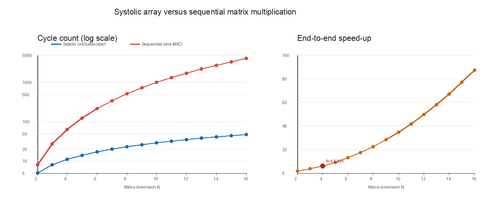

# 5. Performance comparison

The sequential baseline computes one multiply-accumulate (MAC) per clock and therefore needs N³ compute cycles for an N × N multiply. The systolic design needs 3N − 2 compute cycles after skewing the operands through the array, plus one accumulator-clear cycle. At N = 4, these formulas give 64 sequential cycles and 11 systolic cycles end to end.

| Metric (N = 4) | Systolic array | Sequential baseline |
|---|---:|---:|
| Compute cycles | 10 | 64 |
| Total cycles including clear | 11 | 64 |
| End-to-end speed-up | 5.82x | 1x |
| Speed-up excluding systolic clear | 6.4x | 1x |
| Average MACs per compute cycle | 6.4 | 1 |

| N | Systolic total cycles | Sequential cycles | End-to-end speed-up |
|---:|---:|---:|---:|
| 2 | 5 | 8 | 1.6x |
| 4 | 11 | 64 | 5.8x |
| 8 | 23 | 512 | 22.3x |
| 16 | 47 | 4096 | 87.1x |

The cycle counts are derived from the controller schedule and the one-MAC loop bounds, and are confirmed in simulation: `make top` reports ALL 10 TESTS PASSED with `cycle_count = 11` on every test, and `make seq` reports ALL 10 TESTS PASSED with `cycle_count = 64`. The speed-ups in the second table are rounded to one decimal place. The comparison plot is generated at `docs/speedup.png` by `model/plot_speedup.py`.

## Explanation for the report

1. The sequential baseline reuses one signed MAC unit for every output element.
2. It computes N³ products, one per clock, for an N × N matrix multiply.
3. The systolic design places N² processing elements (PEs) in a grid.
4. Skewed A and B inputs make matching operands arrive at each PE together.
5. For N = 4, the array uses 10 compute cycles after one clear cycle; the baseline takes 64 cycles.
6. That is a 5.82x end-to-end speed-up, or 6.4x when the clear cycle is excluded, at the cost of more multiplier hardware.

## Resource cost and wall-clock speed-up

Ranjeet's Vivado run (Section 6; xc7a35tcpg236-1, 100 MHz target) gives the hardware cost of this speed-up:

| Metric | Systolic array | Sequential baseline | Ratio |
|---|---:|---:|---:|
| LUTs | 1,940 | 390 | 4.97× more |
| Flip-flops | 987 | 825 | 1.20× more |
| Fmax | 99.4 MHz | 94.9 MHz | |
| Time per 4×4 multiply | 110.6 ns | 674.4 ns | 6.10× faster |

Because both designs reach almost the same clock frequency, the 5.82× cycle-count advantage becomes a 6.10× wall-clock speed-up, for about 5× the LUTs.

